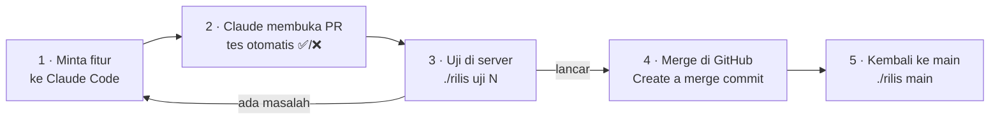

# 🧭 Alur Kerja

Panduan harian: dari minta fitur sampai fitur itu jalan di server. Kalau sesuatu terasa aneh,
langsung lompat ke [Kalau X terjadi, lakukan Y](#-kalau-x-terjadi-lakukan-y).

## Gambaran besar



Kenapa repot begini? Karena **server tidak pernah menjalankan kode yang belum kamu coba**, setiap
versi bisa dikembalikan, dan data selalu di-backup sebelum ada yang berubah.

---

## Alur harian

### 1 · Minta fitur ke Claude Code
Semakin jelas permintaanmu, semakin tepat hasilnya. Pakai kerangka ini:

```
Lanjutkan proyek di repo OWNER/NAMAREPO. Baca CLAUDE.md dulu dan ikuti "Alur kerja"-nya.

## Kondisi sekarang
<apa yang sudah ada dan sudah jalan>

## Yang diminta
1. <fitur pertama, sekonkret mungkin>
2. <fitur kedua>

## Batasan
- <hal yang tidak boleh terjadi, mis. "jangan simpan isi pesan ke database">

## Cara kerja
- Pecah jadi PR kecil. Tunjukkan rencana singkat dulu dan tanyakan hanya keputusan yang perlu.
- Laporan tiap PR: apa yang diubah, apa yang sudah dan belum diverifikasi, cara menguji.
```

Claude akan menunjukkan rencana dan bertanya seperlunya. Jawab singkat saja (mis. "1A 2B").

### 2 · Baca PR-nya
Claude memberi link PR. Di halaman PR, perhatikan:
- **Ringkasan** dan **Cara menguji**: ini yang akan kamu lakukan di langkah 3.
- **Dampak ke server**: kalau ada **variabel `.env` baru**, tambahkan dulu ke `.env` di server.
- **Tes otomatis** di bagian bawah halaman: tunggu sampai ✅. Kalau ❌, minta Claude memperbaikinya dulu.

### 3 · Uji di server
```bash
./rilis            # lalu pilih 1) Uji sebuah PR, masukkan nomornya
# atau langsung:
./rilis uji 7
```
Skrip akan mengambil PR, mem-backup data, menghentikan versi lama, menjalankan PR, lalu menampilkan log.
Cek di Telegram dengan `/versi`: harus tertulis *sedang menguji PR #7*. Lalu ikuti checklist **Cara
menguji** di PR.

Ketemu masalah? Ceritakan ke Claude apa yang terjadi (screenshot atau potongan log sangat membantu).
Claude akan menambah perbaikan ke PR yang sama. Ulangi langkah 3.

### 4 · Merge di GitHub
Di halaman PR: tombol **Merge pull request** → pastikan pilihannya **Create a merge commit** → konfirmasi.

### 5 · Kembali ke main
```bash
./rilis main
```
Server sekarang menjalankan `main` yang sudah berisi fitur barumu. `/versi` → *versi produksi (main)*.

> Lupa server sedang menjalankan apa? Cukup `./rilis status`.

---

## 🛟 Kalau X terjadi, lakukan Y

| Kejadian | Yang dilakukan |
|---|---|
| Bot tidak membalas setelah `uji` | `./rilis log` → lihat pesan error terakhir → kirim ke Claude. Untuk sementara kembali ke versi aman: `./rilis main` |
| `./rilis main` memperingatkan "PR belum di-merge" | Normal kalau kamu memang selesai menguji tanpa merge. Jawab `y` untuk lanjut. Kalau PR itu sudah ditutup tanpa merge, hapus salinannya: `git branch -D pr-<N>` |
| "Ada file yang berubah di server" | Seseorang mengubah file langsung di server. Lihat apa yang berubah (`git status`), buang dengan `git restore <file>`, lalu ulangi. Perubahan selalu lewat PR |
| "PR #N tidak bisa diambil" | Cek nomor PR-nya. Kalau benar, cek deploy key: `ssh -T git@github-NAMAREPO` |
| "Skrip lain sedang berjalan" | Ada `uji`/`main` lain yang belum selesai (mungkin di terminal lain). Tunggu |
| Tes otomatis ❌ di PR | Jangan uji dulu. Minta Claude: "tes di PR #N gagal, tolong perbaiki" |
| Data bot hilang/aneh setelah menguji PR | Pulihkan backup (di bawah) |
| Lupa server sedang menjalankan apa | `./rilis status` |

---

## 🗄 Memulihkan backup

Setiap `./rilis uji` membuat backup di `backups/<waktu>-pr<N>/`. Daftarnya: `./rilis backup`.
Dibutuhkan kalau sebuah PR mengubah format data dan `main` tidak bisa membacanya lagi.

```bash
docker compose stop bot
mv data data.rusak-$(date +%Y%m%d-%H%M%S)        # jangan dihapus dulu
cp -a backups/<waktu>-pr<N>/data ./data
./rilis main
```

Folder `backups/` tidak dibersihkan otomatis. Hapus manual backup lama sesekali kalau disk mulai penuh.

---

## 🔒 Proteksi branch main (sekali saja)

Supaya aturan "jangan push ke main" dan "selalu merge commit" dijaga GitHub, bukan ingatan:

**a. Hanya izinkan merge commit**
Repo → **Settings → General → Pull Requests**:
- ✅ Allow merge commits
- ⬜ Allow squash merging *(matikan)*
- ⬜ Allow rebase merging *(matikan)*

**b. Lindungi `main`**
Repo → **Settings → Rules → Rulesets → New ruleset → New branch ruleset**:
- Nama: `lindungi-main` · Enforcement status: **Active**
- Target branches: **Add target → Include default branch**
- Centang:
  - **Restrict deletions**
  - **Require a pull request before merging** (jumlah approval boleh `0` kalau kamu bekerja sendiri)
  - **Require status checks to pass** → tambahkan `pytest` dan `cek-skrip` (muncul setelah tes otomatis
    pernah berjalan sekali)
  - **Block force pushes**
- **Create**

Nama menu di GitHub bisa sedikit berbeda dari waktu ke waktu; cari bagian *Rulesets* atau *Branch protection*.

---

## 📖 Kamus kecil

| Istilah | Artinya |
|---|---|
| **Repo** | Folder proyek yang disimpan di GitHub, lengkap dengan riwayat perubahannya |
| **main** | Versi resmi proyek. Yang berjalan di server sehari-hari |
| **Branch** | Salinan kerja terpisah. Claude bekerja di branch `claude/...` supaya `main` tidak tersentuh |
| **Pull Request (PR)** | Usulan perubahan dari sebuah branch ke `main`, lengkap dengan penjelasan dan tes |
| **Merge** | Menerima PR: perubahannya masuk ke `main` |
| **Merge commit** | Cara merge yang menyimpan riwayat PR utuh. Skrip memakainya untuk tahu PR mana yang sudah masuk |
| **Deploy key** | Kunci khusus yang membuat server bisa *membaca* repo, tapi tidak bisa mengubahnya |
| **Container** | "Kotak" tempat aplikasi berjalan di server, dibuat oleh Docker |
| **Backup** | Salinan folder data sebelum menguji PR, untuk jaga-jaga |
